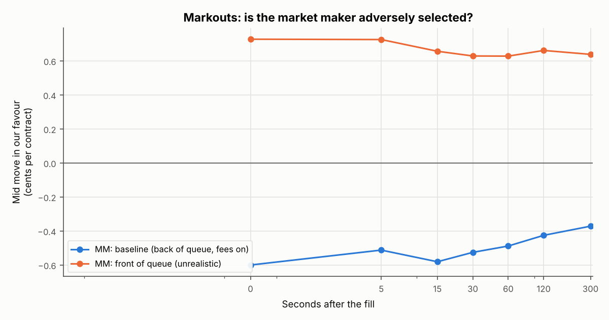
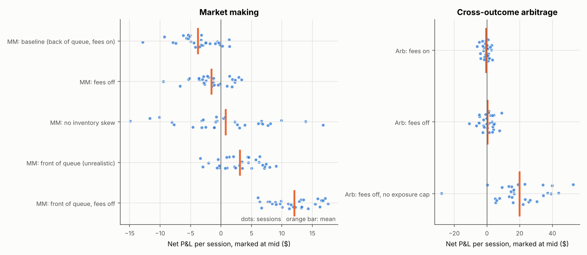
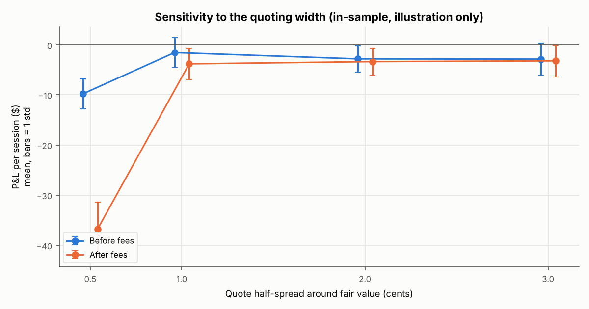
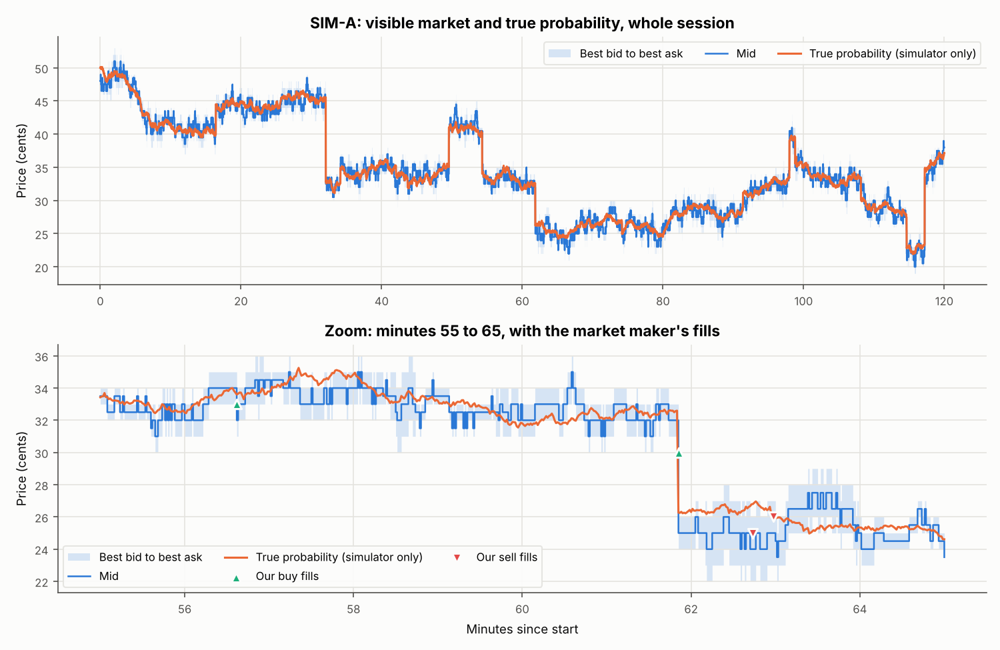
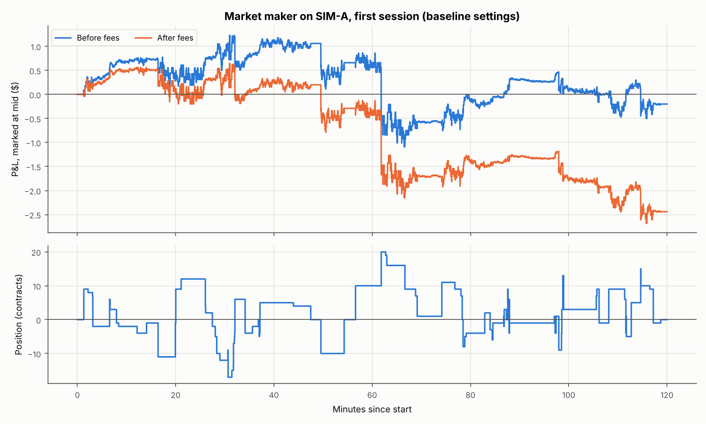
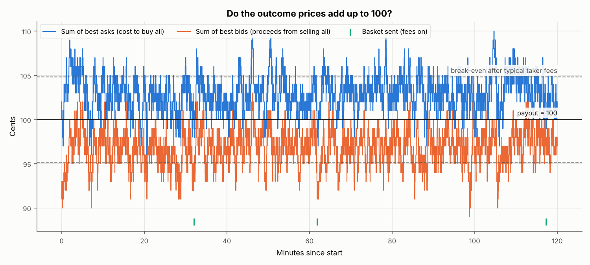

# Prediction market trading system

An event-driven backtester, live data collector and paper trader for binary prediction markets, built around Kalshi's public order book data. It turns order books into trading quantities (spread, mid, microprice, implied probability, depth, imbalance), runs a market-making strategy and a cross-outcome arbitrage check through a conservative fill model with fees, latency and position limits, and reports the results with the caveats they need.

This is a first working draft. All results below come from **simulated** data, because the environment it was built in could not reach any exchange. The code to collect real Kalshi data, backtest it with one command and paper trade on it is included and tested against a replay of simulated data.

## Decisions and assumptions

Choices made without asking, in rough order of importance. Each one is a reasonable default, not the only option.

1. **Data source: Kalshi's public market data API.** Order books, trades, events and markets can be read without an account or API key. Reasons and the alternatives considered are in [Market and data source](#market-and-data-source).
2. **All results in this draft are simulated.** The simulator is described in [Methodology](#the-simulated-market). Its parameters were picked to look like a liquid-ish three-outcome market before any strategy was run, and were not tuned to make strategies look good. One change was made after the first test run: spreads and level sizes were originally redrawn independently every second, which made queue estimates collapse unrealistically fast and flattered the market maker. They now persist over time. This was a realism fix, and it made the results worse rather than better.
3. **Prices are integer cents (1 to 99), contracts pay $1.** A price of 37 is read as an implied probability of 0.37. Integer cents make price comparisons exact.
4. **Shorting YES is allowed** and treated as buying NO at 100 minus the price, which is how it works on Kalshi. P&L is identical; only the collateral differs (handled in paper trading, see point 17).
5. **Fees follow Kalshi's published schedule:** taker fee = 0.07 x contracts x P x (1 - P), maker fee = 0.0175 x contracts x P x (1 - P), rounded up to the next cent. Many Kalshi markets charge makers nothing; charging the maker fee by default is the conservative choice. Fees are rounded per fill rather than per order, which can only overcharge. Fees switch off with `FeeModel(enabled=False)`.
6. **Latency is a fixed 0.5 seconds** for new orders and for cancels. An order sent in reaction to the snapshot at time t cannot trade before t + 0.5 s, and a cancelled order can still be filled during that half second.
7. **Passive fills are conservative.** A new resting order joins the back of the queue; a trade at our price must first use up the queue ahead of us; a trade through our price fills us; and if a later snapshot shows the market has moved through our price, we are filled at our price (this is where adverse selection shows up). Details in [Fill model](#fill-model).
8. **Taker (immediate-or-cancel) orders execute against the next snapshot** after latency, not the snapshot the strategy looked at. Whatever cannot fill at once is cancelled.
9. **Our orders do not move the market.** Later snapshots and trades are exactly as recorded. This is unrealistic and listed under limitations.
10. **Positions are marked at the mid price.** Liquidation P&L (close everything at the touch at the end) and settlement P&L (final payouts) are reported alongside.
11. **Risk limits:** 100 contracts per market, enforced by the engine counting all live orders, not just filled ones. Quote size 10 contracts.
12. **Market maker defaults:** fair value = mid, half-spread 1 cent (rounded outwards to whole cents), inventory skew of 3 cents at the position limit. Quotes are post-only.
13. **Arbitrage defaults:** act only if the edge after taker fees is at least 0.5 cents per basket; basket size 10; stop opening baskets once 30 contracts are left unhedged by partly filled baskets. Leftover legs are held, not repaired.
14. **Sessions are 2 hours long.** Simulated results are averaged over 30 independent sessions (seeds 0 to 29). Real recordings are cut into 2-hour sessions and every session starts flat, so simulated and real numbers are comparable per session.
15. **The Sharpe-style ratio is not annualised.** It is mean over standard deviation of 1-minute P&L within a session. The cross-session version (mean session P&L over its standard deviation) is also reported. Annualising a two-hour simulation would suggest precision it does not have.
16. **The collector timestamps book snapshots with the local clock** at the moment the response arrives. Trades carry Kalshi's own timestamps. Clock skew between the two is not corrected.
17. **Paper trading balance:** collateral works as on Kalshi (a YES costs its price, a short costs 100 minus the price) and live orders reserve their worst-case cost. Selling YES you already hold also reserves collateral, which is conservative. After a restart, orders that were open are treated as cancelled.
18. **Whether an event's outcomes are exhaustive** (exactly one must win) is not provided by Kalshi's API, so the collector defaults to "not exhaustive", which disables the buy-every-outcome basket. Pass `--exhaustive` only after reading the event's rules.
19. **Daily summaries use the Europe/London calendar day.**
20. **No machine learning.** Nothing in the problem needed it.

## Motivation

Prediction markets and betting exchanges are small, accessible versions of the markets quant trading firms work in. They have a central limit order book, a bid-ask spread, makers and takers, fees, queue priority, latency and inventory risk. A binary contract that pays $1 also has a clean interpretation: its price is the market's probability estimate, so "fair value" has a concrete meaning.

That makes them a good place to study the questions that matter in real market making: when does a resting quote actually get filled, who is on the other side, how much of the spread survives fees and adverse selection, and how much of a backtest's profit comes from its assumptions rather than its strategy.

## Quick start

```bash
pip install -r requirements.txt
python -m pytest                 # 45 unit and integration tests, a few seconds
python scripts/run_all.py        # simulated pipeline: 30 sessions x 11 scenarios, about 2 minutes
```

Results go to `results/simulated/` (tables) and `results/simulated/charts/` (PNG charts).

**Real data.** On your own machine (this needs internet access to Kalshi):

```bash
python -m data.kalshi list-events --limit 20                      # find an event
python -m data.kalshi collect --event EVENT_TICKER --interval 5 --out data/raw/myevent
# or: python -m data.kalshi collect --markets TICKER1 TICKER2 --interval 5 --out data/raw/mine
# Leave it running. Ctrl+C to stop; run the same command again to resume.
python -m data.kalshi settle --out data/raw/myevent               # once the markets resolve
python scripts/run_all.py --data data/raw/myevent --compare       # backtest real data + compare with simulated
```

**Paper trading** (no orders are sent anywhere):

```bash
python -m paper.trader run --strategy mm --markets TICKER --balance 1000 --interval 5 --out paper_runs/mm1
python -m paper.trader summary --out paper_runs/mm1               # daily summary + backtest on the same period
```

## Project structure

```
data/
  schema.py         standard data format, cleaning, snapshot building, session splitting
  simulator.py      simulated multi-outcome market (true probability, books, informed and noise trades)
  kalshi.py         Kalshi API client, parsing, resumable collector, settlement lookup (CLI)
  storage.py        save/load datasets (CSV or Parquet)
  loader.py         load_market_data("simulated" | directory)
orderbook/
  book.py           OrderBookSnapshot: best bid/ask, spread, mid, microprice, depth, imbalance
  metrics.py        metrics tables, odds/probability conversion, overround, basket prices
strategies/
  base.py           Strategy interface and the actions a strategy can send
  market_maker.py   inventory-skewed market maker
  cross_outcome_arb.py  buy-all / sell-all basket arbitrage
backtest/
  events.py         merges books and trades into one time-ordered event stream
  engine.py         event-driven engine: latency, limits, balance, fills, equity
  fill_model.py     when a resting order counts as filled
  fees.py           Kalshi-style fee model, switchable
  orders.py         Order, Fill, Side
  portfolio.py      cash, positions, mark-to-market, liquidation and settlement value
  metrics.py        P&L, risk, fill rates, markouts, basket statistics
paper/
  trader.py         live paper trading through the same engine (CLI)
  report.py         daily summary and paper-versus-backtest comparison
scripts/
  run_all.py        runs everything and writes tables and charts
  plotting.py       charts
tests/              unit tests plus collector/paper tests on a replayed simulation
results/simulated/  outputs of the last simulated run
data/simulated/seed0/  the first simulated session, saved in the standard format
```

## Market and data source

| Option | Real order book data | Cost and access for a UK student | Verdict |
|---|---|---|---|
| **Kalshi** | Public REST endpoints for order books (bids for YES and NO), trades (with the taker's side), events and markets. No account or key needed to read. | Free. Reading data needs nothing. Trading has historically been limited to US residents, but this project never trades. | **Chosen.** |
| Betfair Exchange | Full ladder via the API with a live app key; the free delayed key returns only 3 price levels, delayed by 1 to 60 seconds, and no traded volume by selection. | The live key costs a one-off £299 and Betfair does not allow read-only use of it. Free historical data (BASIC) is last traded price once a minute with no volume; order-book-level history (ADVANCED, PRO) is paid. | Best liquidity and the obvious UK choice, but not free for real order book data. |
| Polymarket | Public order book endpoint per outcome token. | Reading is free, but the UK is on Polymarket's list of countries blocked from placing orders. | Usable for data only; a fetcher is a sensible next step. |

Kalshi won on three practical points beyond cost. Its fee formula is published and simple, which matters when the question is whether an edge survives fees. Events carry a `mutually_exclusive` flag, which the arbitrage check needs. And each public trade says whether the taker bought or sold, which the fill model needs to know which of our resting orders a trade could have hit.

One quirk: Kalshi returns only bids, for YES and for NO. A NO bid at p is an offer to sell YES at 100 - p (one YES plus one NO always pays exactly $1), so `data/kalshi.py` converts NO bids into YES asks.

**What is real and what is simulated in this draft.** The collector, parsers, storage, session splitting, real-data pipeline and paper trader are complete and tested, but only against documented example payloads and a replay of simulated data. They have not been run against the live Kalshi API. Every number in [Results](#results-simulated-data) is from the simulator.

## Methodology

### Order book metrics

For each snapshot (`orderbook/book.py`):

* **Best bid / best ask:** highest buy price and lowest sell price.
* **Spread** = best ask - best bid, in cents.
* **Mid** = (best bid + best ask) / 2. **Implied probability** = mid / 100.
* **Microprice** = (bid x ask size + ask x bid size) / (bid size + ask size). It leans towards the side with less size, because that side is more likely to be traded through next.
* **Depth:** total size in the best n levels of one side.
* **Imbalance** = (bid depth - ask depth) / (bid depth + ask depth), in [-1, 1].
* **Basket prices** (multi-outcome events): sum of best asks across outcomes (cost to buy one of each) and sum of best bids (proceeds from selling one of each).

### The simulated market

`data/simulator.py` produces data in exactly the format the collector writes:

* **True probabilities.** Three mutually exclusive outcomes (initially 50%, 30%, 20%). Each has a latent score that follows a random walk with occasional jumps (about four "news" jumps per outcome per hour); a softmax turns the scores into probabilities that always sum to 1.
* **Other traders' quotes.** Each book is centred on the true probability plus a persistent quoting error (an AR(1) process with a standard deviation of 1 cent and a half-life of about 14 seconds). This error creates mispricings, including baskets that do not add up to 100.
* **Book shape.** Spread of 1 to 4 cents that changes every 20 seconds or so; 5 levels a side; sizes that grow with depth and persist over time; more size on the side the true price is moving towards.
* **Trades.** Poisson arrivals at 0.12 per second per outcome. 30% are informed: they know the true probability 20 seconds ahead and trade only when the book is wrong. The rest buy or sell at random. All trades are at the best bid or ask.
* **Settlement.** One winner drawn from the final true probabilities.

Snapshots are every second. A session is 2 hours.

### Backtest engine

`backtest/engine.py` is event-driven. Books and trades are merged into one time-ordered stream (`backtest/events.py`; at equal timestamps, trades come first because a snapshot reflects trades up to its time). For each event the engine:

1. applies cancels whose latency has passed,
2. activates orders whose latency has passed and sets their queue position (post-only orders that would cross are rejected),
3. for a trade, asks the fill model which of our resting orders it would have filled,
4. for a snapshot, updates the book, checks resting orders against it, executes due taker orders against it, then asks the strategy for new actions,
5. records cash, fees, positions and mark-to-market equity.

**Lookahead protection.** The strategy receives a read-only `StrategyContext` built only from events already processed: latest books, positions, its own open orders. It never sees the event list, the true probabilities or the settlement. Every action takes effect strictly after the event that caused it, plus latency. Tests check that a strategy never sees a book from the future, that an order cannot fill before latency has passed, and that a taker order cannot trade at prices it saw but that have since gone.

**Strategies are separate from the engine.** A strategy implements one method, `on_book_update(market_id, context)`, and returns actions (`PlaceLimit`, `PlaceTaker`, `Cancel`). The engine handles latency, limits, fees, fills and accounting. Adding a strategy means adding one file in `strategies/`.

### Fill model

`backtest/fill_model.py`. The historical data does not contain our orders, so the backtest has to decide how the market would have treated them. For a resting BUY at price p (SELL is the mirror image):

1. **Back of the queue.** When the order goes live, everything already displayed at p is assumed to be ahead of us.
2. **Queue only shrinks for good reasons.** A public trade at p first uses up the queue ahead of us. If a later snapshot shows less size at p than our queue estimate, the estimate is capped at the displayed size. Other cancellations are assumed to come from behind us.
3. **Trade-through.** A sale below p would have hit our better bid first, so we fill, up to the trade's size.
4. **Market moves through us.** If a snapshot shows an offer at or below p, someone was willing to sell at our price, so we fill at p, up to the size offered. These are the fills you would rather not get: they tend to happen just before the price keeps falling. Ignoring them would flatter the results.
5. **Volume is shared, not duplicated.** One trade can fill at most its own size across all our orders.

An optional `"front"` setting assumes we are always first in the queue. It is unrealistic and exists only to show how much the queue assumption is worth.

### Costs

Kalshi's fee formula (Decision 5), charged on every fill. The fee per contract is largest at 50 cents (1.75 cents for takers, 0.44 cents for makers) and small near 0 or 100. For a three-leg arbitrage basket around typical prices, taker fees come to roughly 4 to 5 cents per basket, which is more than most mispricings.

### Strategy 1: inventory-skewed market maker

`strategies/market_maker.py`. On every book update in its market:

* fair value = mid,
* reservation price = fair value - 3 cents x (position / 100),
* bid = floor(reservation - 1), ask = ceil(reservation + 1), pushed back if needed so it never crosses the book,
* bid size shrinks to zero as the position approaches +100, ask size as it approaches -100,
* an order already at the right price is left alone, to keep its place in the queue.

The skew is the simplest version of the Avellaneda-Stoikov idea: when long, lower both quotes, so that buying more becomes less likely and selling more likely.

### Strategy 2: cross-outcome arbitrage

`strategies/cross_outcome_arb.py`. In an event whose outcomes are mutually exclusive, at most one YES pays $1.

* **Buy every outcome** if sum of best asks + taker fees < 100. This is risk free only if the outcomes are also exhaustive (exactly one wins).
* **Sell every outcome** if sum of best bids - taker fees > 100. This only needs mutual exclusivity.

When the edge after fees is at least 0.5 cents, the strategy sends one immediate-or-cancel order per outcome at the prices it saw. They arrive after latency, so some legs may not fill. Unfilled legs leave an unhedged position, which this simple version holds to settlement and reports. It stops opening baskets once 30 contracts are unhedged.

### Metrics

`backtest/metrics.py`: net and gross P&L (marked at mid), fees, liquidation P&L, settlement P&L, number of fills, contracts traded, passive fill rate (share of quoted contracts that filled), taker fill rate, maximum and average absolute inventory, standard deviation of 1-minute P&L, Sharpe-style ratio, maximum drawdown, and **markouts**: for each fill, how far the mid moved in our favour 0, 5, 15, 30, 60, 120 and 300 seconds later. Negative markouts mean we are being picked off.

## Results (simulated data)

30 independent two-hour sessions per scenario, same sessions for every scenario. "Net P&L" is per session, after fees, marked at mid. The standard error of each mean is its std divided by about 5.5 (the square root of 30).

| Scenario | Net P&L $ (mean) | Net P&L $ (std) | Gross P&L $ | Fees $ | Liquidation P&L $ | Profitable sessions | Fills | Max abs inventory | Max drawdown $ |
|---|---|---|---|---|---|---|---|---|---|
| MM: baseline (back of queue, fees on) | -3.82 | 3.14 | -1.58 | 2.24 | -3.87 | 10% | 75 | 22 | 4.81 |
| MM: fees off | -1.58 | 2.95 | -1.58 | 0.00 | -1.63 | 27% | 75 | 22 | 3.55 |
| MM: no inventory skew | 0.74 | 7.27 | 3.92 | 3.18 | 0.43 | 50% | 114 | 74 | 9.66 |
| MM: front of queue (unrealistic) | 3.08 | 3.42 | 12.01 | 8.93 | 3.03 | 77% | 342 | 32 | 3.49 |
| MM: front of queue, fees off | 12.01 | 3.50 | 12.01 | 0.00 | 11.96 | 100% | 342 | 32 | 2.71 |
| MM: half-spread 0.5c | -36.77 | 5.35 | -9.80 | 26.98 | -36.83 | 0% | 668 | 24 | 36.97 |
| MM: half-spread 2c | -3.38 | 2.68 | -2.83 | 0.55 | -3.47 | 3% | 14 | 24 | 4.45 |
| MM: half-spread 3c | -3.22 | 3.18 | -2.88 | 0.34 | -3.36 | 7% | 7 | 25 | 4.73 |
| Arb: fees on | -0.53 | 2.26 | 0.17 | 0.70 | -0.84 | 47% | 5 | 19 | 3.50 |
| Arb: fees off | 0.34 | 4.27 | 0.34 | 0.00 | -0.73 | 57% | 18 | 50 | 9.70 |
| Arb: fees off, no exposure cap | 19.82 | 15.66 | 19.82 | 0.00 | 18.14 | 97% | 582 | 100 | 20.22 |

Full tables: `results/simulated/scenario_summary.csv`, one row per session in `results/simulated/runs.csv`.

### Market making

**The baseline market maker loses money, before and after fees.** It averages -$1.58 per session before fees and -$3.82 after, and is profitable in 3 of 30 sessions. The Sharpe-style ratio across sessions is -1.2.

**The reason is adverse selection, and the markouts show it directly.** On average the baseline's fills are 0.6 cents per contract worse than the mid at the moment of the fill, and still 0.4 cents worse five minutes later. Only 9% of its filled volume came from reaching the front of a queue. 56% came from trades through its price (it was quoting inside a wide spread) and 36% from the market moving through its quote. These are exactly the situations where someone with better information is on the other side.



**Almost all of the "edge" in a naive backtest is the queue assumption.** With the same strategy, same data and same fees, assuming we are always first in the queue turns -$1.58 gross into +$12.01, and -$3.82 net into +$3.08. Fills more than quadruple (342 against 75), 72% of them now come from the queue, and markouts turn positive (+0.7 cents). In this simulation, a backtest that ignores queue position would report a profitable strategy that is in fact losing.



**Fees matter a lot at this scale.** Even maker fees (0.0175 rate) take $2.24 per session from the baseline, more than its gross loss. Quoting tighter (half-spread 0.5 cents) trades nine times as often and the fees alone ($26.98) are larger than everything else in the table.

**Inventory skew controls risk, and it costs money here.** Without skew, maximum inventory is 74 contracts instead of 22 and the P&L standard deviation more than doubles (7.27 against 3.14), with settlement P&L far more dispersed (std $19.6 against $5.0). But mean P&L is higher without skew (+$0.74 against -$3.82, about three standard errors apart). In this simulation the true probability has no drift, so holding inventory costs nothing on average; skewing pays the spread to get rid of inventory, which is pure cost in expectation and only buys lower variance. In a real market where inventory tends to build up just before adverse moves, skew may earn its keep. That is a question for real data.

**Wider quotes do not escape adverse selection.** At half-spreads of 2 and 3 cents the strategy rarely trades (14 and 7 fills per session), and the fills it does get are mostly the market moving through it, with markouts around -3 cents at 30 seconds. All four widths lose after fees. The sweep is in-sample and on simulated data, so it is not evidence for any particular setting.



A single session in detail, with the true probability that the strategy cannot see:




### Cross-outcome arbitrage

| Per session (means) | Fees on | Fees off | Fees off, no cap |
|---|---|---|---|
| Distinct mispricings seen (positive edge before fees) | 261 | 254 | 262 |
| Of which survive taker fees and the 0.5c minimum | 6 | 254 | 262 |
| Baskets sent | 3.2 | 8.0 | 262 |
| Completely filled | 0.27 | 3.3 | 102 |
| Partly filled (legging) | 2.8 | 4.6 | 157 |
| Net P&L, marked at mid | -$0.53 | +$0.34 | +$19.82 |
| Settlement P&L (mean, std) | +$0.07, $7.06 | +$0.39, $9.01 | +$7.76, $48.6 |
| Contracts left unhedged at the end | 24 | 33 | 137 |

**The prices regularly fail to add up to 100, but taker fees remove almost every opportunity.** About 2% of the mispricings survive three legs of taker fees.

**Legging risk, not the mispricing, decides the outcome.** Only about one basket in twelve fills completely with fees on, and fewer than half with fees off. The orders arrive half a second later and execute against the next snapshot, by which time one of the three prices has often moved by a cent. Partly filled baskets are not arbitrage. They are directional bets on which outcome wins.

**The most "profitable" arbitrage line is the most misleading one.** Without fees and without an exposure cap, the strategy shows +$19.82 per session marked at mid, profitable in 97% of sessions. At settlement the same positions average +$7.76 with a standard deviation of $48.6, because it ends each session holding 137 unhedged contracts. Marking to mid hides that risk.



### What this does and does not say

The simulation was built with informed traders and noisy quotes, so a naive market maker losing money in it is partly by construction. The useful results are the *relative* ones: how much the queue assumption, fees, latency and marking method change the answer for the same strategy on the same data. They are what to check first on real data.

## Real data and paper trading

**Collector** (`python -m data.kalshi collect`). Polls the order book and recent trades of the chosen markets every N seconds and appends them to `books.csv` and `trades.csv` in the standard format, flushing after every poll. On restart it cuts off a half-written last line, reloads the trade ids already saved so no trade is written twice, restores its trade cursor from `collector_state.json`, and carries on. A test simulates a crash mid-line and a restart and checks that every trade is saved exactly once.

**Backtest on real data** (`python scripts/run_all.py --data DIR --compare`). Loads the recording, cuts it into 2-hour sessions, runs every scenario with the same strategies, engine and metrics, and writes `results/real_<name>/`. With `--compare` it also runs the simulated sessions and writes `results/comparison_<name>/comparison.md` and a chart of simulated against real P&L per session. Arbitrage scenarios run only if the markets were collected as mutually exclusive.

Two lessons from testing this path on a replayed simulation:

* **A few sessions from one recording prove very little.** A replayed 8-hour simulated path, cut into four sessions, showed the baseline market maker at +$1.30 per session, against -$3.82 over 30 independent sessions. Nothing changed but the sample. Sessions from one recording are also correlated with each other. Collect for many days before reading anything into real results.
* **Polling interval matters, and coarser data makes market making look worse.** Re-running 12 simulated sessions with snapshots every 1, 2 and 5 seconds gave mean net P&L of -$3.41, -$4.45 and -$6.83. With slower snapshots the strategy updates its quotes less often, so they go stale and get run over (market-moving-through fills rise from 21% to 39% of the total). A real bot would react to every update, so backtests on 5-second polls are pessimistic for a market maker. Poll as fast as rate limits allow.

**Paper trading** (`python -m paper.trader run`). Feeds live polls into the same `BacktestEngine` the backtests use, with a fake balance (default $1,000), and logs every order event (`orders.csv`), fill (`fills.csv`) and the running balance, P&L, fees and positions after every poll (`equity.csv`). `summary` writes a daily summary and re-runs the backtest on the market data the paper trader recorded for exactly the same period, side by side.

On a replay where trades arrive in time order, paper and backtest results match exactly (same fills, same P&L), which is a useful check that the live path really is the same code. Live, they should differ for reasons the report lists: trades are only discovered at the next poll, a trade that arrives after our order went live but happened before it cannot fill us, and a restart drops open orders. The size of that gap is a direct measure of how optimistic the backtest is.

## Limitations and what the results do NOT show

* **No real data yet.** Every number above is simulated. The simulator encodes my assumptions about informed flow, spreads and quote noise; a strategy that works or fails in it says as much about those assumptions as about the strategy.
* **Our orders have no market impact.** The data is replayed as if we were never there. Other traders do not react to our quotes and our taker orders do not move later prices. For a small, slow strategy this matters less; for anything that trades a lot relative to displayed size it matters a great deal.
* **The fill model is a model.** Queue position is estimated, not known. Cancellations are assumed to come from behind us, which is conservative but not certain. Hidden orders and other makers' reactions to our quotes are ignored.
* **Fills on book crosses use displayed size.** In reality, some of the quotes that crossed our level might have been post-only and cancelled instead of trading with us.
* **Polled data is coarse.** With snapshots every few seconds, everything that happened between polls is invisible except the trades, and trade timestamps (Kalshi's clock) and book timestamps (local clock) are not perfectly aligned.
* **Taker liquidity is the displayed book,** with no competition from other arbitrageurs. Real arbitrage is a speed race, and the fastest participants would take most of these opportunities first. Results for the arbitrage scenarios are optimistic in that respect, and pessimistic in that legging would be less frequent on a faster connection.
* **Marking at mid is generous** for strategies that end with inventory. Liquidation and settlement P&L are reported for this reason, and for the arbitrage strategy they tell a very different story.
* **The half-spread sweep is in-sample.** It shows sensitivity, not an optimal setting. There is no out-of-sample test in this draft.
* **30 sessions is a small sample** for a strategy whose session P&L has a standard deviation of $3 or more. Differences under about $1.50 between scenarios are within noise.
* **Fee schedules change.** The Kalshi formula and rates were checked in November 2026; some series have their own multipliers. Check `fee_type` and `fee_multiplier` for the markets you trade.
* **No settlement-time effects.** Prices converge to 0 or 100 as an event resolves, and spreads and informed trading change near the end. The simulation does not model this.

## Next steps

Roughly in order of usefulness:

1. Run the collector for a week or more on a few liquid Kalshi events and compare real results with simulated ones.
2. Paper trade the baseline market maker alongside, and measure the paper-versus-backtest gap.
3. Calibrate the simulator to real data (trade rates, spread distribution, quote noise, how often the book moves through a level), then re-run.
4. Add the improvements listed at the end of `NOTES.md`, starting with a better fair value and an out-of-sample parameter test.
5. Add a Polymarket fetcher (public order book endpoint) for a second venue, and a cross-venue comparison for events listed on both.

## Sources

* [Betfair: application keys and the £299 activation fee](https://betfair-developer-docs.atlassian.net/wiki/x/BBYp)
* [Betfair: delayed versus live key](https://betfair-developer-docs.atlassian.net/wiki/x/URAp)
* [Betfair Data Scientists: historic data tiers (BASIC, ADVANCED, PRO)](https://betfair-datascientists.github.io/data/usingHistoricDataSite)
* [Polymarket: order books](https://docs.polymarket.com/market-data/prices-order-books.md)
* [Polymarket: geographic restrictions](https://docs.polymarket.com/api-reference/geoblock.md)
* [Kalshi: public market data quick start](https://docs.kalshi.com/getting_started/quick_start_market_data)
* [Kalshi: order book responses](https://docs.kalshi.com/getting_started/orderbook_responses)
* [Kalshi: trades endpoint](https://docs.kalshi.com/api-reference/market/get-trades)
* [Kalshi: events endpoint](https://docs.kalshi.com/api-reference/events/get-event)
* [Kalshi fee schedule](https://kalshi.com/docs/kalshi-fee-schedule.pdf)
* [Polymarket fees in 2026 (secondary source)](https://www.rivermarkets.com/insights/polymarket-fees.html)
